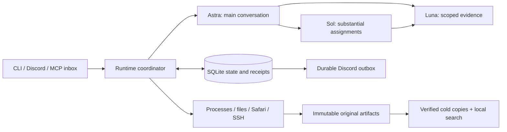

# Architecture

Bloom separates authored requests, accepted state, native model messages and
external effects. SQLite is authoritative; TOML and Markdown are authoring
inputs or human views, not parallel state machines.

## Execution and recovery

Operations receive durable identities before effects. Completed effects and
model responses are reused; uncertain outcomes require reconciliation. Tool
output publication, task lifecycle and owner-message usage attribution have
separate receipts. Foreground waits collect existing work without invoking
the model to poll. Public progress reports observed results and intended tools.

The coordinator freezes committed source for deployment while runtime data stays
in the workspace. Source rollback is different from restoring a conversation.
Workers use scoped directories/process controls, and substantial code changes
use Git worktrees and reviewed submissions.

## Memory

There is one continuous Astra. Its day/episode/event hierarchy, accepted state
and persona facts retain references to original messages and actions. Retrieval
uses lexical full-text search plus hierarchical expansion, not a learned
embedding index. Exact original ranges remain addressable.

Astra explicitly chooses recall/evidence assignments. Luna cannot publish
semantic memory; Sol proposals also require Astra approval. Accepted changes
do not mutate an already-sent prompt prefix. They enter the next compacted
snapshot, while explicit retrieval appends evidence to the current history.

Sol agents have durable task/session records, but independently resident Sol
identities with their own long-term memory and Discord-server bindings are not
implemented by this draft.

## Evidence and web input

Captured pages and native images are preserved as originals. The automatic
model-facing view uses one extracted document per page. Generic large results
and selected research evidence can be curated by Luna; exact excerpts, original
hashes and retrieval paths accompany the compact view. Preservation on disk
does not require repeated inclusion in the model prompt.

See [web research](web-search.md) for extraction and image details.

## Module map

| Modules | Responsibility |
| --- | --- |
| `runtime.py`, `store.py`, `schema.sql` | Coordination, durable state and lifecycle |
| `models.py`, `context.py`, `token_estimate.py` | Providers, native history and context accounting |
| `assignments.py`, `workers.py`, `evidence.py` | Delegation, joins and scoped evidence |
| `memory.py`, `semantic_upkeep.py`, `working_context.py` | Source-backed memory and compaction |
| `tools.py`, `execution.py`, `remote_files.py` | Tool dispatch and supervised execution |
| `web.py`, `safari.py`, `safari_helper.py`, `web_document.py` | Browser evidence and model projections |
| `results.py`, `research_views.py` | Saved large results and working-evidence budgets |
| `delivery.py`, `gateway.py`, `activity.py` | Discord intake, outbox and activity |
| `storage.py`, `backups.py`, `reset.py`, `service.py` | Archival, backup, reset and deployment |

Configuration, prompts and tests live outside `src/` to make policy and behavior
reviewable together.
