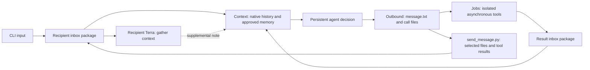

# What owns what



One `Loop` schedules every identity. There is no separate research coordinator,
report approval pipeline or case-specific lifecycle. Sending a message never
closes a persistent identity. A sleeping agent resumes when a material inbox
message arrives; unchanged waits do not call a model.

| Object | Owns |
|---|---|
| `Store` | Original payloads, immutable event files, rebuildable SQLite index |
| `Agents` / `Actor` | Persistent identities, same-owner branches, filesystem grants |
| `Messages` | Complete text/attachment packages and delivery/consumption receipts |
| `Context` | Native history, fixed prefixes, tool versions, memory and owning compaction |
| `Models` / `Responses` | Shared purchase admission, provider transport, exact receipts |
| `Jobs` | Frozen tool execution, process lifecycle, scoped API credentials |
| `Tool` | Small worker client for filesystem, models, services and authorized actions |
| `Delivery` | Authenticated attachment and publication primitives |
| `Loop` | Readiness, Terra context requests, decisions, output dispatch and recovery |
| `BrowserService` | Serialized ordinary Safari capture, source retention and scoped exports |

Search strategy lives in `tools/bundled/search.py`; sender preparation lives in
`send_message.py`. The browser library does capture, not relevance judgments.
Tool schemas come from each Python file's typed `run(tool, ...)` and docstring,
without importing its code into the host. Execution receives a job-bound client.

```text
src/bloom41/                 small common harness
lib/bloom_safari/            native Safari adapter and document projection
  web_assets/               Swift, AppleScript, extraction JS, vendored Readability
tools/bundled/               ten standalone starting tools
profiles/                   role instructions
tests/                      offline scripted and real subprocess checks
scripts/                    maintained verification workflows

<runtime-root>/
  control/                  private event journal, runtime lock, broker credentials
  artifacts/
    objects/                immutable original bytes, keyed by full SHA-256
    web/<date>/<operation>/ retained browser sources and native images
  index.sqlite3             disposable projection of file receipts
  workspace/
    agents/<id>/
      identity.toml
      instructions.md
      tools/*.py            actual available, editable tool implementations
      inbox/<message>/      message.txt, attachments/, provenance.json
      outbound/<turn>/      message.txt, calls/*.json
      history/              exact native operations
      memory/               L0.md, L1.md, L2/*.md
      work/                 writable work and source copies
        plan.md             task hierarchy, owners, dependencies and results
      scratch/              private drafts and temporary files
    branches/<id>/          independent files/history under the same owner
    shared/memory/          readable by owners; only continuous Astra approves edits
    jobs/<scope>/<job>/     frozen code, request, status and executor log
    user/inbox/             final messages for the CLI user
    web/                   helper bundle, browser lease and recovery spool
  logs/                     development or diagnostic runs
```

Runtime state belongs under its chosen root; source and credentials are not
copied into message packages. The event index can be reconstructed with `reindex`.
An ambiguous accepted model/tool effect is surfaced, never silently replayed.
`resume` is an explicit operator decision after inspecting those receipts.

An agent may edit `work/`, `scratch/` and its own `tools/`. New forks have a
read-only `memory/` link to their owner, with independent work/scratch files.
Parent source grants are read-only
for self-forks. Terra reads its owner's files but can only write its own temporary
tool scratch. It also has read access to the branches it monitors. Durable memory needs the exact native approval from the owning
decision. The macOS sandbox enforces file access; the broker derives authority
from execution credentials, not a caller-supplied identity.
